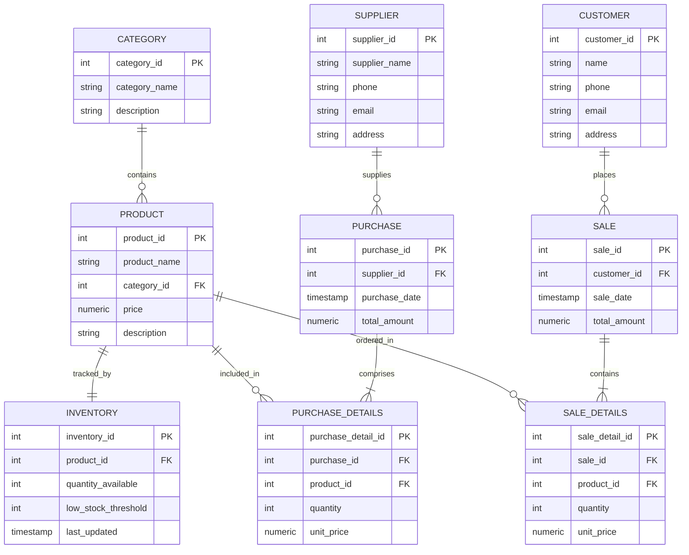

# E-Commerce Management System (DBMS Project)

Complete Relational Database Management System (DBMS) & Web Application built with **PostgreSQL**, **Python (Flask)**, and a **Modern Dark Navy + Teal** web interface.

Designed strictly following the project blueprint specification.

---

## 📑 Table of Contents
1. [Project Overview](#project-overview)
2. [Technology Stack](#technology-stack)
3. [Folder Structure](#folder-structure)
4. [Database Design & Schema (9 Tables)](#database-design--schema)
5. [Entity-Relationship (ER) Diagram](#entity-relationship-er-diagram)
6. [Normalization & Database Integrity](#normalization--database-integrity)
7. [Core Business Logic Workflows](#core-business-logic-workflows)
8. [REST API Documentation](#rest-api-documentation)
9. [Quick Setup & Installation Guide](#quick-setup--installation-guide)
10. [Default Credentials](#default-credentials)

---

## 1. Project Overview
The **E-Commerce Management System** replaces manual, disjointed spreadsheets with a centralized relational database. It ensures transactional integrity across inventory stock levels, suppliers, customer directories, procurement purchases, and point-of-sale operations.

---

## 2. Technology Stack
* **Database:** PostgreSQL (with pgAdmin 4 or Neon Cloud support)
* **Backend:** Python 3.x, Flask, `psycopg2-binary` (parameterized queries against SQL injection)
* **Frontend:** HTML5, Modern CSS3 (Dark Navy `#101827` + Teal `#14B8A6`), Vanilla JavaScript ES6
* **Architecture:** Decoupled RESTful API Client-Server Architecture

---

## 3. Folder Structure
```text
E-Commerce-Management-System/
├── backend/
│   ├── routes/
│   │   ├── __init__.py
│   │   ├── auth.py          # Authentication (login/register)
│   │   ├── customers.py     # Customer CRUD & sales linkage
│   │   ├── products.py      # Products & categories
│   │   ├── suppliers.py     # Supplier directory
│   │   ├── purchases.py     # Purchase orders & stock increment
│   │   ├── sales.py         # Sales checkout & stock decrement
│   │   ├── inventory.py     # Warehouse stock & threshold alerts
│   │   ├── reports.py       # Analytics & analytical views
│   │   └── ai.py            # AI Assistant natural language queries
│   ├── services/
│   │   ├── __init__.py
│   │   ├── purchase_service.py # Atomic purchase transactions
│   │   ├── sale_service.py     # Atomic sale & stock validation
│   │   ├── inventory_service.py# Dashboard KPIs & stats
│   │   └── ai_service.py       # Live DB AI query & viva copilot
│   ├── app.py               # Flask application entry point
│   ├── config.py            # Environment config reader
│   ├── database.py          # PostgreSQL driver & connection pool
│   ├── requirements.txt     # Python dependencies
│   ├── schema.sql           # PostgreSQL table definitions & constraints
│   ├── seed_data.sql        # Rich seed records matching project mockup
│   └── test_api.py          # Automated API test suite
├── frontend/
│   ├── css/
│   │   └── style.css        # Blueprint-compliant Dark Navy + Teal theme
│   ├── js/
│   │   ├── api.js           # Central API HTTP Client
│   │   └── script.js        # Modals, toasts, floating AI assistant widget
│   ├── index.html           # Main dashboard with KPI cards & wave chart
│   ├── login.html           # Admin & staff sign-in
│   ├── products.html        # Product catalog & category management
│   ├── inventory.html       # Stock levels & low-stock warnings
│   ├── customers.html       # Customer directory
│   ├── suppliers.html       # Supplier & vendor management
│   ├── purchases.html       # Inbound purchase order entry
│   ├── sales.html           # Point of sale & customer invoice generation
│   ├── reports.html         # Analytics & top-seller leaderboards
│   └── ai-assistant.html    # Full-screen AI Assistant & Viva Copilot
├── .env.example             # Sample environment variables
├── .env                     # Local environment settings
├── .gitignore
├── setup_database.py        # Automated PostgreSQL/SQLite schema runner
├── run.py                   # One-click application runner
├── Start_Project.bat        # Double-click startup script
└── README.md
```

---

## 4. Database Design & Schema
The relational database contains **9 core tables** + authentication table:

| # | Table Name | Primary Key | Foreign Keys | Key Attributes & Description |
|---|---|---|---|---|
| 1 | `Users` | `user_id` | - | `username`, `email`, `password_hash`, `role` |
| 2 | `Customer` | `customer_id` | - | `name`, `phone`, `email`, `address` |
| 3 | `Category` | `category_id` | - | `category_name`, `description` |
| 4 | `Supplier` | `supplier_id` | - | `supplier_name`, `phone`, `email`, `address` |
| 5 | `Product` | `product_id` | `category_id` -> `Category` | `product_name`, `price`, `description` |
| 6 | `Inventory` | `inventory_id` | `product_id` -> `Product` | `quantity_available`, `low_stock_threshold` |
| 7 | `Purchase` | `purchase_id` | `supplier_id` -> `Supplier` | `purchase_date`, `total_amount` |
| 8 | `Purchase_Details` | `purchase_detail_id` | `purchase_id`, `product_id` | `quantity`, `unit_price`, `subtotal` |
| 9 | `Sale` | `sale_id` | `customer_id` -> `Customer` | `sale_date`, `total_amount` |
| 10 | `Sale_Details` | `sale_detail_id` | `sale_id`, `product_id` | `quantity`, `unit_price`, `subtotal` |

---

## 5. Entity-Relationship (ER) Diagram



---

## 6. Normalization & Database Integrity
* **1NF (First Normal Form):** Every cell contains atomic values. Repeating item lists are isolated into relational tables (`Purchase_Details`, `Sale_Details`).
* **2NF (Second Normal Form):** All non-key attributes are fully functionally dependent on primary keys. Composite keys are cleanly separated.
* **3NF (Third Normal Form):** No transitive dependencies exist. Product attributes (e.g. price, description) depend only on `product_id`, not on transactions.
* **Integrity Constraints:**
  - Foreign keys enforce referential integrity with cascading updates and restricted deletions.
  - `CHECK (quantity > 0)`, `CHECK (price >= 0)`, and `CHECK (total_amount >= 0)` prevent negative numbers.
  - Parameterized SQL prevents SQL injection.

---

## 7. Core Business Logic Workflows

### 🛒 Purchase Workflow (Inbound Restock)
1. Select Supplier.
2. Select Product(s), enter wholesale quantity and unit price.
3. Transaction starts (`BEGIN`):
   - Insert into `Purchase` header table.
   - Insert line items into `Purchase_Details`.
   - Update `Inventory`: `quantity_available = quantity_available + purchase_quantity`.
4. Transaction completes (`COMMIT`).

### 💳 Sales Workflow (Outbound Order)
1. Select Customer.
2. Select Product(s) and desired quantity.
3. **Stock Verification:** Check `Inventory.quantity_available >= requested_quantity`.
   - *If stock is insufficient:* Operation is strictly rejected with a clear error message.
4. Transaction starts (`BEGIN`):
   - Insert into `Sale` header table.
   - Insert line items into `Sale_Details`.
   - Update `Inventory`: `quantity_available = quantity_available - sale_quantity`.
5. Transaction completes (`COMMIT`) and printable tax invoice is generated.

---

## 8. REST API Documentation

| Method | Endpoint | Description |
|---|---|---|
| `POST` | `/api/auth/login` | Authenticate staff/admin user |
| `GET` | `/api/products` | Retrieve catalog with stock status & search filters |
| `POST` | `/api/products` | Add a new product and initialize stock |
| `PUT` | `/api/products/<id>` | Update product details |
| `DELETE`| `/api/products/<id>` | Remove product from catalog |
| `GET` | `/api/products/categories` | Retrieve product categories |
| `GET` | `/api/customers` | List all customer profiles |
| `POST` | `/api/customers` | Register a new customer |
| `PUT` | `/api/customers/<id>` | Update customer information |
| `GET` | `/api/suppliers` | List verified vendors |
| `POST` | `/api/suppliers` | Register new supplier |
| `GET` | `/api/purchases` | Inbound purchase transaction history |
| `POST` | `/api/purchases` | Create purchase order & restock inventory |
| `GET` | `/api/sales` | Ledger of retail sales |
| `POST` | `/api/sales` | Checkout sale transaction (with stock check) |
| `GET` | `/api/sales/<id>` | Fetch detailed invoice receipt |
| `GET` | `/api/inventory` | Real-time warehouse inventory and status |
| `PUT` | `/api/inventory/<id>` | Adjust stock levels or threshold alerts |
| `GET` | `/api/inventory/dashboard/stats` | KPI summary (Products, Sales, Low Stock) |
| `GET` | `/api/reports/summary` | Analytics (Top sellers, VIP customers, suppliers) |

---

## 9. Quick Setup & Installation Guide

### Step 1: Install Python Requirements
Open terminal or VS Code in this project folder and run:
```bash
pip install -r backend/requirements.txt
```

### Step 2: Configure PostgreSQL Database
1. Make sure your PostgreSQL service is running (e.g. pgAdmin 4).
2. Open `.env` file in the root folder and verify your password:
   ```env
   DB_HOST=localhost
   DB_PORT=5432
   DB_NAME=ecommerce_db
   DB_USER=postgres
   DB_PASSWORD=your_postgres_password
   ```

### Step 3: Initialize Database Schema & Seed Data
Run the automated initialization script:
```bash
python setup_database.py
```
*Note: If PostgreSQL is not configured yet, the script automatically initializes a local database so you can preview and test immediately!*

### Step 4: Run the Application
Start the server with:
```bash
python run.py
```

Now open your web browser at:
👉 **`http://localhost:5000`**

---

## 10. Default Credentials
* **Username:** `admin`
* **Password:** `admin123`
*(Stored using cryptographic salt and hash in the database)*
